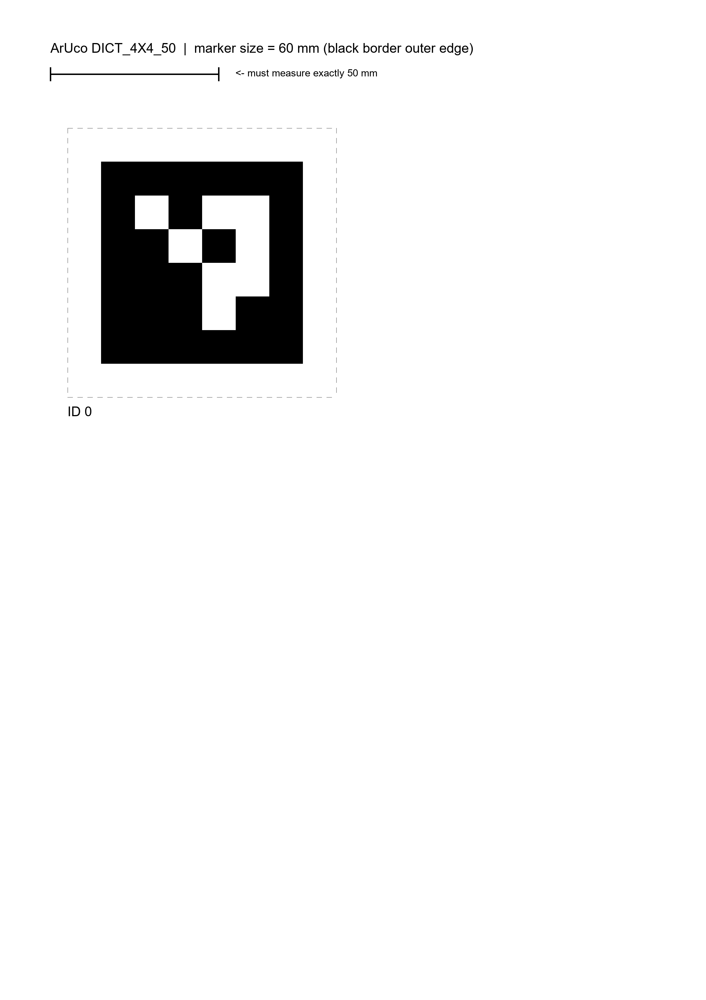
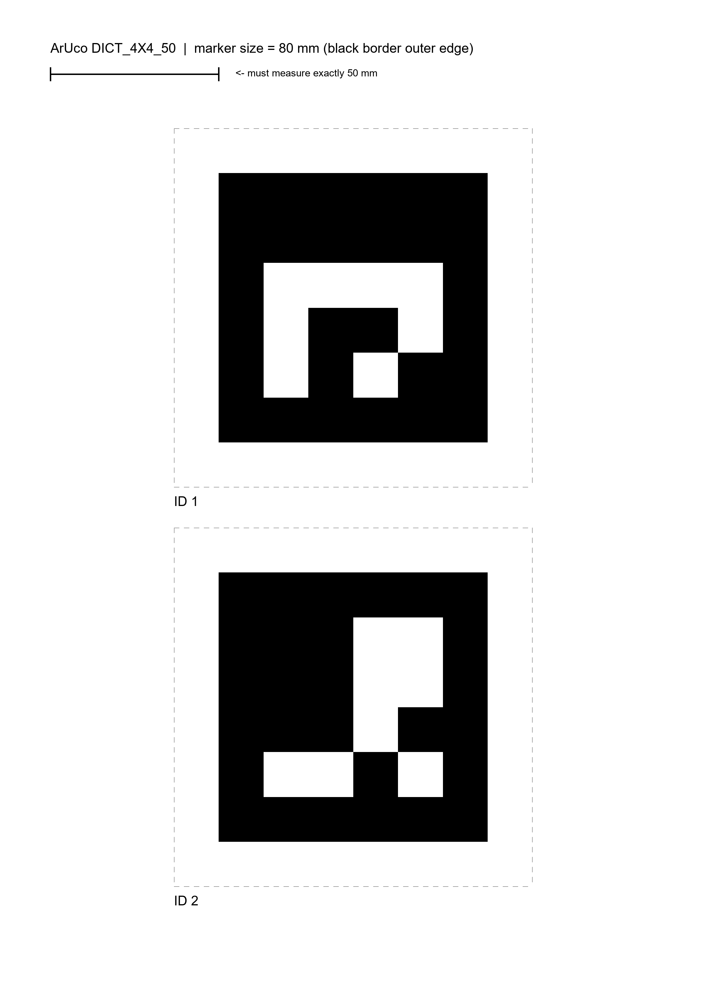

# TurtleBot3 ArUco 마커 인식 (쓰레기통 · 벽)

TurtleBot3 Waffle Pi + OpenMANIPULATOR-X 쓰레기 수거 시연에서 사용하는 ArUco 마커 인식 코드와 인쇄물.

- **시나리오**: 출발 → Nav2 이동 → 쓰레기 줍기(D435i + YOLO) → Nav2 이동 → **쓰레기통 마커로 정렬** → 버리기
- **역할 분담**: Pi 카메라 = ArUco 마커 인식 / D435i = YOLO 인식 · 뎁스
  (집는 순간 D435i 시야가 가려지므로 Pi 카메라를 별도로 사용)

---

## 1. 시스템 구성

```
[Raspberry Pi 4]  ── 이더넷 직결 (192.168.10.x) ──  [Jetson Orin Nano]
 camera_ros (Pi Camera v2)                           turtlebot3 bringup, Nav2
 aruco_node.py → /aruco/*                            D435i + YOLO, MoveIt, grasp_node
 전원: OpenCR 5V                                     전원: 별도 배터리 + DC-DC
```

| 항목 | 내용 |
|---|---|
| ROS | ROS 2 Humble (두 보드 공통), `ROS_DOMAIN_ID=30` |
| Pi 카메라 | Raspberry Pi Camera v2.1 (IMX219), 640×480 |
| 마커 사전 | `DICT_4X4_50` |
| OpenCV | RPi apt 4.5.x / Orin 4.11 — 두 API 모두 지원 |

> Pi Camera v2는 Orin Nano CSI에 직접 연결도 가능 (15핀↔22핀 변환 케이블 필요). 케이블이 생기면 RPi 없이 Orin 단독 구성으로 바꿀 수 있다.

---

## 2. 파일 구조

```
.
├── aruco_node.py        # ROS 2 마커 인식 노드 (RPi에서 실행)
├── make_markers.py      # 인쇄용 마커 PDF 생성
└── markers/
    ├── aruco_markers_60mm.pdf   # ID 0 (쓰레기통)       ← 인쇄
    ├── aruco_markers_80mm.pdf   # ID 1, 2, 3 (벽)       ← 인쇄
    └── *.png                    # 미리보기
```

---

## 3. 마커 구성

| ID | 부착 위치 | 크기 | 비고 | 발행 토픽 |
|---|---|---|---|---|
| 0 | 원형 쓰레기통 (지름 19 cm) | 60 mm | 원통 곡면 보정 | `/aruco/bin_pose`, `/aruco/bin_center` |
| 1 | 벽 | 80 mm | 평면 | `/aruco/wall_1_pose` |
| 2 | 벽 | 80 mm | 평면 | `/aruco/wall_2_pose` |
| 3 | 벽 | 80 mm | 평면 | `/aruco/wall_3_pose` |

| 쓰레기통 (60 mm) | 벽 (80 mm) |
|---|---|
|  |  |

### 크기 선정 근거
Pi Camera v2 (640×480, fx ≈ 532 px)에서 마커가 약 30 px 이상이면 안정적으로 인식된다.

| 크기 | 0.5 m | 1.0 m | 1.5 m |
|---|---|---|---|
| 40 mm | 43 px | 21 px ✗ | 14 px ✗ |
| 60 mm | 64 px | 32 px | 21 px |
| 80 mm | 85 px | 43 px | 28 px |

쓰레기통은 지름이 작아(19 cm) 80 mm를 붙이면 둘레의 48°를 감싸 테두리가 크게 휜다 → **60 mm** (36°, 중앙 돌출 4.7 mm).

---

## 4. 인쇄 · 부착

1. `markers/aruco_markers_60mm.pdf` (1장), `markers/aruco_markers_80mm.pdf` (2장) 인쇄
2. 인쇄 배율 **"실제 크기(100%)"** — "페이지에 맞춤" 끄기
3. 상단 기준선이 **정확히 50 mm** 인지 자로 확인
4. 회색 **점선을 따라** 자르기 (안쪽 흰 여백은 인식에 필수)
5. 검은 테두리 바깥 끝~끝을 실측해서 `aruco_node.py`의 `size`에 입력
6. 부착
   - 쓰레기통: 마커를 **똑바로 세워서** 가로 방향으로 휘도록 밀착 (90° 돌리면 보정 방향이 틀어짐)
   - 벽: 평평하게, Pi 카메라와 비슷한 높이
   - 무광 종이 사용, 테이프로 마커 면을 덮지 않기

다른 크기·ID가 필요하면:
```bash
pip install opencv-python pillow
python make_markers.py 80 4 5      # 80 mm, ID 4·5
```

---

## 5. 환경 설정

### 5.1 네트워크 (RPi ↔ Orin 이더넷 직결)
```bash
# Orin (NetworkManager) — 인터페이스 이름은 `ip a`로 확인
sudo nmcli con add type ethernet ifname eth0 con-name robot-link \
  ipv4.method manual ipv4.addresses 192.168.10.1/24
sudo nmcli con up robot-link
```
```yaml
# RPi: /etc/netplan/50-cloud-init.yaml 의 ethernets: 아래
    eth0:
      dhcp4: false
      addresses: [192.168.10.2/24]
```
```bash
sudo netplan apply
```

### 5.2 ROS 환경 변수 (두 보드 `~/.bashrc`)
```bash
export ROS_DOMAIN_ID=30
export ROS_LOCALHOST_ONLY=0
export TURTLEBOT3_MODEL=waffle_pi
```

### 5.3 시간 동기화 (chrony) — TF extrapolation 에러 방지
```bash
sudo apt install chrony   # 두 보드
```
- Orin `/etc/chrony/chrony.conf`: `allow 192.168.10.0/24`, `local stratum 10`
- RPi `/etc/chrony/chrony.conf`: 기존 `pool` 주석 처리 후 `server 192.168.10.1 iburst`
- `sudo systemctl restart chrony` → RPi에서 `chronyc tracking` 으로 ms 단위 오차 확인

### 5.4 RPi 패키지
```bash
sudo apt install ros-humble-camera-ros ros-humble-cv-bridge python3-opencv python3-scipy
# 카메라 미인식 시 /boot/firmware/config.txt 에 dtoverlay=imx219 추가 후 재부팅
```

### 5.5 Pi 카메라 캘리브레이션 (필수)
캘리브레이션 값(`camera_info`)이 없으면 `aruco_node`는 아무것도 발행하지 않는다.
```bash
# RPi: 카메라
ros2 run camera_ros camera_node --ros-args -p width:=640 -p height:=480

# Orin(모니터 연결): 체커보드 8x6 내부코너, 한 칸 25 mm 예시
sudo apt install ros-humble-camera-calibration
ros2 run camera_calibration cameracalibrator --size 8x6 --square 0.025 \
  --ros-args -r image:=/camera/image_raw -p camera:=/camera
```
보드를 여러 위치·각도·거리로 움직여 X/Y/Size/Skew 바가 초록색이 되면 **CALIBRATE → SAVE** → yaml을 RPi로 복사 (`~/pi_camera.yaml`).

---

## 6. 실행

```bash
# RPi 터미널 1: 카메라
ros2 run camera_ros camera_node --ros-args -p width:=640 -p height:=480 \
  -p camera_info_url:=file:///home/ubuntu/pi_camera.yaml

# RPi 터미널 2: 마커 인식
python3 aruco_node.py

# Orin: 확인
ros2 topic list | grep aruco
ros2 topic hz /aruco/bin_pose          # 10 Hz 이상
ros2 topic echo /aruco/wall_1_pose     # 30 cm 앞에 두면 position.z ≈ 0.30
```
토픽 이름이 다르면 `aruco_node.py` 상단 `IMAGE_TOPIC`, `INFO_TOPIC` 수정.

---

## 7. `aruco_node.py` 구조

### 설정 (이 부분만 수정)
```python
MARKERS = {
    0: dict(name="bin",    size=0.060, cyl_radius=0.095),  # 원형 쓰레기통 (지름 19 cm)
    1: dict(name="wall_1", size=0.080),
    2: dict(name="wall_2", size=0.080),
    3: dict(name="wall_3", size=0.080),
}
OFFSET = {}   # 실측 보정값 (m, 카메라 광학 프레임) 예: {0: (0.0, 0.0, 0.004)}
AVG_N = 5     # 이동 평균 프레임 수
```

| 함수 | 역할 |
|---|---|
| `object_points()` | 마커 네 모서리 3D 좌표 생성. 원통 마커는 현(chord) 폭 사용 |
| `info_cb()` | `camera_info`에서 내부 파라미터 K, 왜곡 D 수신 |
| `img_cb()` | 마커 검출 → `solvePnP(IPPE)` → 원통 보정 → 5프레임 평균 → 발행 |
| 출력 | `PoseStamped`, **카메라 광학 프레임** 기준 (z 앞, x 오른쪽, y 아래) |

### 원통(쓰레기통) 곡면 보정
ArUco는 마커가 평평하다고 가정한다. 원통에 감긴 마커는:
1. 네 모서리는 휘어도 **한 평면 위**에 있다 → 폭을 현의 길이 `2r·sin(θ/2)` (θ = size/r) 로 두고 `solvePnP`
2. 그 평면은 표면보다 `r·(1−cos(θ/2))` 안쪽 → 표면 위치 보정 (`/aruco/bin_pose`)
3. 그 평면에서 `r·cos(θ/2)` 더 안쪽이 원통 중심축 (`/aruco/bin_center`)

합성 투영 검증 (r = 9.5 cm, 60 mm 마커):

| 조건 | 보정 없음 | 보정 후 |
|---|---|---|
| 0.5 m, 정면 | 4.7 mm | 0.00 mm |
| 0.8 m, 20° | 4.7 mm | 0.00 mm |
| 1.0 m, −30° | 4.7 mm | 0.00 mm |

> 실제 영상에서는 모서리 검출 오차가 추가되므로 아래 실측 보정을 함께 한다.

### 실측 오프셋 보정
1. 카메라 앞 알려진 위치에 마커를 두고 실제 거리를 자로 측정
2. `ros2 topic echo`로 10회 정도 평균
3. 3~5개 위치(가까이/멀리, 좌/우)에서 반복
4. (실측 − 측정) 평균을 `OFFSET`에 입력
   위치마다 오차가 크게 다르면 `size`나 카메라 캘리브레이션 문제

---

## 8. 향후 작업 (TODO)

```
[RPi]  camera_node ─ aruco_node ──▶ /aruco/bin_pose, bin_center, wall_N_pose
                                         │
[Orin] static TF (카메라 위치) ─▶ tf2 변환 (카메라 → base_link / link1 / map)
                                         │
     ┌───────────────────────────────────┼─────────────────────────┐
     ▼                                   ▼                         ▼
 ③ wall_localizer                  ④ bin_aligner              ⑤ drop
 벽 마커로 AMCL 위치 보정             쓰레기통 앞 미세 정렬        통 중심 위로 팔 이동 → 놓기
     └──────────── ⑥ mission_node (전체 시나리오 상태 머신) ────────────┘
```

- [ ] **① 카메라 캘리브레이션** — `pi_camera.yaml` 생성 (5.5절)
- [ ] **② static TF** — Pi 카메라 부착 위치 실측
  ```bash
  ros2 run tf2_ros static_transform_publisher --x .. --y .. --z .. \
    --roll .. --pitch .. --yaw .. --frame-id <부착 링크> --child-frame-id <camera_ros frame_id>
  ```
  광학 프레임(z 앞)과 로봇 프레임(x 앞) 차이로 보통 `roll=-90°, yaw=-90°` 회전 필요.
  팔에 달려 있으면 부모 프레임을 해당 링크로 해야 팔이 움직여도 좌표가 맞는다.
- [ ] **③ `wall_localizer.py`** — 벽 마커로 AMCL 위치 보정
  - 벽 마커의 지도 좌표 기록: `WALL_MAP = {1: (x, y, yaw), ...}`
  - `T_map_base = T_map_marker × inv(T_base_marker)` → `/initialpose` 발행
  - 1.5 m 이내 · 안정적으로 보일 때만, 쿨다운(약 10 s), 정지 상태에서 보정
- [ ] **④ `bin_aligner.py`** — 쓰레기통 앞 미세 정렬 (Nav2 도착 오차 ≈ 5 cm 보정)
  - `/aruco/bin_pose` → `base_link` 변환 → 거리 · 좌우 · 각도 오차
  - P제어로 `/cmd_vel` (예: 목표 거리 0.25 m, 허용 1 cm · 2°)
  - 마커 안 보이면 즉시 정지, **Nav2 목표 종료 후에만** 실행 (`/cmd_vel` 충돌 방지)
- [ ] **⑤ 놓기 동작** — `/aruco/bin_center` → `link1` 변환, 통 높이 + 5 cm 위로 이동 후 그리퍼 열기
  (기존 `grasp_node`의 해석적 IK + MoveIt 재사용)
- [ ] **⑥ `mission_node.py`** — 전체 시나리오
  ```
  START → GO_TRASH(Nav2) → GRASP(YOLO → /cola/target_point → grasp_node)
        → GO_BIN(Nav2) → [LOCALIZE] → ALIGN_BIN(④) → DROP(⑤) → DONE
  ```
  `nav2_simple_commander.BasicNavigator.goToPose()` 사용, 단계별 타임아웃 · 재시도

**추천 순서**: ① → `aruco_node` 동작 확인 → ② → ④ → ⑤ → ⑥ → ③(필요 시)

---

## 9. 트러블슈팅

| 증상 | 원인 · 해결 |
|---|---|
| 토픽이 발행되지 않음 | `camera_info` 미수신 → `camera_info_url` 확인 |
| 거리가 일정 비율로 틀림 | `size` 실측값 오류 또는 인쇄 배율 |
| 인식이 안 됨 | 반사, 흰 여백 부족, 마커가 너무 작음(30 px 미만) |
| Orin에서 토픽이 안 보임 | `ROS_DOMAIN_ID`, 네트워크, 방화벽 확인 |
| TF extrapolation 에러 | 보드 간 시간 동기화(chrony) 확인 |
| 값이 떨림 | `AVG_N` 증가, 조명 개선, 카메라 고정 |
